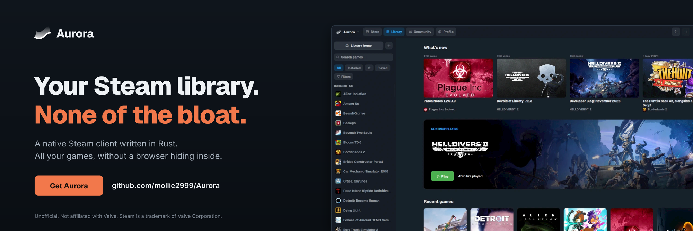

<p align="center">
  
</p>

<p align="center">
  <a href="https://mollie2999.github.io/Aurora/"><b>Website</b></a> ·
  <a href="#download"><b>Download</b></a> ·
  <a href="#every-game-launches"><b>Games</b></a> ·
  <a href="#status"><b>Status</b></a> ·
  <a href="#benchmarks"><b>Benchmarks</b></a> ·
  <a href="CHANGELOG.md"><b>Changelog</b></a>
</p>

<p align="center">
  <a href="https://github.com/mollie2999/Aurora/releases/latest"></a>
  
  
</p>

# Aurora

A Steam client written in Rust, with no browser inside. Store, library,
downloads, friends, chat, Workshop, inventory, Market and Steam Cloud, drawn
natively with [egui](https://github.com/emilk/egui) in one process. It signs in
to your own Steam account and talks to Steam's servers directly.

Aurora is a fork of [SteamInRust](https://github.com/madonchik123/SteamInRust)
that adds Linux: it builds and runs there (Wayland and X11) and starts every
kind of game in your library.

## Every game launches

Aurora starts installed Steam games through the windowless Steam host by
default when Aurora is online and the host is available. The host uses your
installed Steam engine for Steamworks and ownership checks.

On Linux, games with both builds installed use the native build by default.
Manage › Compatibility switches a game to Proton or to a specific Proton
version. On Windows, games run natively.

The first time you try an anti-cheat game on the headless host, Aurora asks
you to acknowledge the risk of launch failures, kicks or bans. The official
Steam client is still available for games that need it. Compatible games can
also start when the host is unavailable.

## Status

Aurora's feature coverage compared with Valve's Steam desktop client on
Windows and Linux.

**0** unavailable · **0.25** limited support · **0.5** usable with major gaps ·
**0.75** most common workflows covered · **1** covers the workflows Aurora
targets for that feature. The table notes intentional exclusions, browser
handoffs, and Steam dependencies. Compatibility can vary by game, platform,
and package.

| Steam desktop feature | Aurora / 1 | Coverage and limits |
| --- | ---: | --- |
| Sign-in and accounts | 1 | Password, Steam Guard, QR sign-in, and saved accounts. Sensitive account changes open Steam's website. |
| Steam Families | 0.75 | Shared library, family creation, invites, and member management. Parental controls and purchase requests open Steam's website. |
| Offline mode and reconnecting | 0.75 | Cached library, offline launches for supported games, and automatic reconnect. Steam's handling of reported offline playtime is unconfirmed. |
| Library and collections | 0.75 | Search, filters, non-Steam shortcuts, and synced static collections. Steam's dynamic collections are read-only. |
| Downloads, installs, and storage | 1 | Queued and resumable downloads, drag reordering, scheduled updates, file verification, library moves, and backup and restore. Local network game transfers are outside Aurora's scope. |
| Store and purchases | 1 | Search, trailers, wishlist, Discovery Queue, Points Shop, and review writing. Payment is handled on Steam's website. |
| Friends and chat | 0.75 | Friends list, presence, invites, direct messages, and group text chats. Voice channels are visible in group chat, with no support for voice calls. |
| Community | 0.75 | Activity feed, profile editing, game hubs, guides, and discussion browsing. Some community actions still open Steam's website. |
| Workshop | 0.75 | Browse, subscribe, and download mods. Publishing support covers single-file uploads through the in-game API. |
| Inventory, trading, and Market | 0.5 | View inventory, check prices, list items, and send basic trade offers. The trade inbox and Market browsing open Steam's website. |
| Steam Cloud | 1 | Per-game sync, conflict resolution with local backups, and viewing and deleting remote saves. |
| Game launch and Proton | 1 | Native Linux launches and per-game Proton selection. The windowless Steam host is the default when available. Anti-cheat games show a first-launch warning. |
| In-game Steam features | 0.75 | Achievements, stats, lobbies, and other Steamworks features on supported routes. Aurora's own implementation lacks Steam Datagram Relay for modern multiplayer. |
| Steam Input | 0.5 | Controller testing, calibration, per-game overrides, community layouts, and binding editing. In-game support depends on the game and launch route. |
| Shift+Tab overlay | 1 | In-game rendering on supported Windows games and via a Vulkan layer on Linux, with a window fallback on some launch paths. Includes notes, screenshots, and an FPS counter. An in-game browser is outside Aurora's scope. |
| Desktop integration | 0.75 | Desktop notifications and tray menus on Windows and supported Linux desktops. Registering Aurora as the `steam://` link handler is Windows-only. |
| Settings, languages, and updates | 0.75 | English, French, Spanish, and Russian UI. The Windows installer updates automatically. Linux updates depend on the package. |
| Steam Broadcast | 0.25 | Aurora can watch live broadcasts on Linux. Hosting broadcasts is unavailable. |
| Big Picture | 0.75 | Fullscreen Library, Store, Downloads, Friends, text chat, and settings with controller and keyboard navigation. |
| Remote Play | 0 | No game streaming or Remote Play Together. |
| Game Recording | 0 | No gameplay clip recording. |

Open Big Picture with the monitor button, the app menu, the controller's
Guide button while Aurora is focused, or `aurora --bigpicture`. Use
`--bigpicture=window` to open it in a window.

To try Aurora’s Deck interface on a desktop, use `aurora --steam-deck`
(full screen) or `aurora --steam-deck=window`. Press F2 or click **Quick Access**
while Big Picture has focus. Press Esc to go back, F1 for the main menu, and
F11 to toggle fullscreen.
The preview uses your normal Aurora library and settings. It does not emulate
Deck hardware, claim a SteamOS session, or activate system-level controls.

See [Steamworks compatibility](docs/steam-compatibility.md) for in-game API
details and the [changelog](CHANGELOG.md) for release history.

## Benchmarks

Aurora 0.7.2 against the official Steam client (build 1792618285, no
mods), on the same PC and account: Ryzen 7 5700X, 16 GB RAM, GeForce RTX
5070, CachyOS with GNOME on Wayland. Measured on 16 November 2026. Each figure
is the median of 3 runs after a warm-up run.

| | Steam | Aurora |
| --- | ---: | ---: |
| Start → first window | 2.77 s | 0.14 s |
| Start → main window, signed in | 4.90 s | 2.16 s |
| Memory when idle (PSS, all its processes) | 1,408 MB | 166 MB |
| CPU when idle | 18 % of a core (9–33 %) | 0.2 % |
| Processes | 16 | 1 |
| Program size | 2,129 MB | 46 MB |

Steam signs in automatically; its first window is its sign-in window.
Aurora's first window is its account picker, which the script clicked as soon
as it showed. Idle figures are
taken 45 s after the main window opened, CPU over the next 30 s. Steam's
program size leaves out games, user data, caches and compatibility tools.
Aurora still needs a Steam install on Linux for Proton and the Steam host.

Method, script and every run: [docs/benchmarks-linux.md](docs/benchmarks-linux.md).

## Download

From [the latest release](https://github.com/mollie2999/Aurora/releases/latest):

| File | Platform |
| --- | --- |
| `Aurora-Linux-x86_64.tar.gz` | Linux x86_64. Unpack and run `aurora` |
| `Aurora-<version>-x86_64.flatpak` | Experimental Linux x86_64 bundle (`flatpak install --user ./Aurora-<version>-x86_64.flatpak`) |
| `aurora-bin-<version>-x86_64.pkg.tar.zst` | Arch Linux package (`sudo pacman -U …`) |
| `aurora_<version>_amd64.deb` | Debian, Ubuntu 22.04+, Mint (`sudo apt install ./aurora_…deb`) |
| `Aurora-Setup-<version>.exe` | Windows 10/11 installer, updates itself |
| `Aurora-<version>-portable.zip` | Windows, no installer |

The experimental Flatpak keeps its own settings and library data. It bundles the `steamhost` helper, which needs access to Valve’s Steam engine to launch games through the headless Steam path. Use a native package for host Steam, Proton, and in-game overlay integration. To update the Flatpak, install the new bundle from the release page.

Store trailers on Linux need `ffmpeg`, and `libpulse` for sound.

## Build from source

Needs [Rust](https://rustup.rs). On Linux, install the libudev development package (`libudev-dev` on Debian and Ubuntu).

```sh
git clone https://github.com/mollie2999/Aurora.git
cd Aurora
cargo build --release -p aurora -p steamhost
target/release/aurora            # sign in with your account
target/release/aurora --demo     # sample data, no sign-in
```

The Windows `steamclient` DLLs that Proton games load are built by CI
(`.github/workflows/build.yml`); copy them next to `aurora` from a release.

## Is it safe to use?

- **Your account.** Aurora signs in the way the official client and the Steam
  Mobile app do. Your sign-in stays on your PC and is only sent to Steam.
- **Anti-cheat.** Aurora shows a risk warning before each anti-cheat game's
  first launch through the windowless Steam host.
- **Other connections.** Steam, GitHub (updates), an exchange-rate service
  (gift regions) and, if you add a key, IsThereAnyDeal. No telemetry.

## Credits

Built on [SteamInRust](https://github.com/madonchik123/SteamInRust) by
madonchik123. Fonts: [Geist](https://github.com/vercel/geist-font) and
[Inter](https://rsms.me/inter/) (OFL). Icons: [Phosphor](https://phosphoricons.com) (MIT).
Protocol definitions: [SteamDatabase/Protobufs](https://github.com/SteamDatabase/Protobufs).

## License

[MIT](LICENSE). Unofficial. Not affiliated with Valve. Steam is a trademark of
Valve Corporation.
